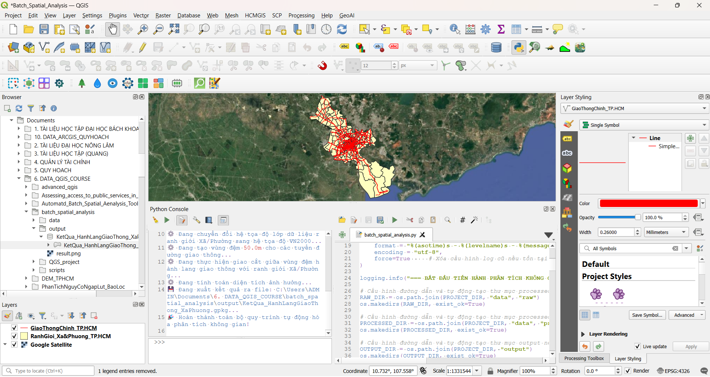
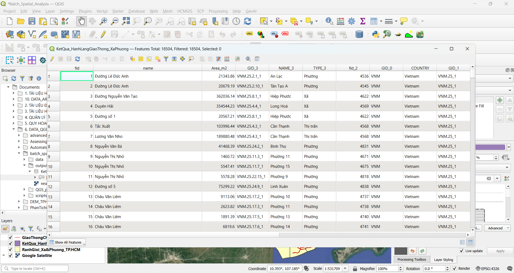

# TỰ ĐỘNG HÓA PHÂN TÍCH DỮ LIỆU KHÔNG GIAN (PYQGIS)

## 📌 Tổng quan Dự án

Dự án này xây dựng một quy trình tự động hóa phân tích không gian hàng loạt (Batch Spatial Analysis) tại khu vực Thành phố Hồ Chí Minh bằng ngôn ngữ Python và thư viện **PyQGIS** chạy trực tiếp trong môi trường QGIS để tối ưu hóa quy trình phân tích không gian lặp đi lặp lại.

Quy trình này thay thế các thao tác thủ công tốn thời gian trên phần mềm máy tính bằng một quy trình xử lý hàng loạt mạnh mẽ, giúp tự động hóa các tác vụ như:

    1. Kiểm tra và sửa lỗi hình học (topology) cho các lớp dữ liệu.

    2. Chuẩn hóa hệ tọa độ vuông góc phẳng quốc gia VN-2000.

    3. Tạo vùng đệm (Buffer) hành lang an toàn 50m cho hệ thống đường giao thông chính.

    4. Giao cắt không gian (Spatial Intersection) giữa vùng đệm với ranh giới hành chính cấp Xã/Phường.

    5. Tự động tính toán lại diện tích ảnh hưởng ($m^2$) và xuất kết quả thành phẩm dưới dạng tập tin GeoPackage (.gpkg).

---

## 🛠️ Phần mềm & Kỹ năng

* **Phần mềm GIS:** QGIS 3.44.15

* **Ngôn ngữ lập trình:** Python 3.12

* **Thư viện:** PyQGIS (`qgis.core`, `processing`)

* **Định dạng dữ liệu:** GeoPackage (`.gpkg`)

* **Các khái niệm chính:** Chỉ mục (Spatial Indexing), Quy trình xử lý dữ liệu vector (Vector Processing Pipelines), Phân tích dữ liệu không gian tự động, Lập trình PyQGIS (QGIS Scripting).

---

## 📊 Dữ liệu đầu vào

Dữ liệu Ranh giới Xã/Phường TP.HCM thu thập từ GADM (url:https://gadm.org/download_country.html).
Dữ liệu vị trí các tuyến đường giao thông chính tại khu vực TP.HCM thu thập từ nguồn dữ liệu mở OpenStreetMap (OSM).

* `GiaoThongChinh_HCM.gpkg`: Mạng lưới các tuyến đường giao thông chính tại khu vực TP.HCM (Line, 10062 đối tượng).
* `RanhGioi_Xa&Phuong_HCM.gpkg`: Ranh giới hành chính Xã/Phường TP.HCM (Polygon, 322 đối tượng).

---

## 📂 Cấu trúc thư mục dự án

```
batch_spatial_analysis/
│
├── data/
│   ├── raw/                                                   # Dữ liệu vector đầu vào gốc (WGS84 - EPSG:4326)
│   │   ├── GiaoThongChinh_HCM.gpkg
│   │   └── RanhGioi_Xa&Phuong_HCM.gpkg
│   │
│   └── processed/                                             # Dữ liệu sau khi đã được xử lý theo quy trình
│       ├── Fixed_GiaoThongChinh_HCM.gpkg
│       ├── Fixed_RanhGioi_Xa&Phuong.gpkg
│       ├── VN2000_GiaoThongChinh_HCM.gpkg
│       ├── VN2000_RanhGioi_Xa&Phuong_HCM.gpkg
│       ├── VN2000_Buffer50m_GiaoThongChinh_HCM.gpkg
│       └── VN2000_Intersection_GiaoThong&RanhGioi_HCM.gpkg
│
├── output/
│   ├── KetQua_HanhLangGiaoThong_XaPhuong.gpkg                 # Kết quả phân tích không gian thành phẩm
│   ├── run_scripts.png                                        # Kết quả chạy chương trình trong PyQGIS
│   └── result.png                                             # Kết quả thu được sau khi thực hiện phân tích dữ liệu không gian tự động thành công  
│    
├── QGS_project/                                               # File dự án đinh dạng .qgz
│   └── Batch_Spatial_Analysis.qgz
│
├── scripts/
│   └── batch_spatial_analysis.py                              # Đoạn code Python tự động hóa quy trình PyQGIS
│
├── batch_analysis.log                                         # Nhật ký thực hiện quy trình
│
└── README.md                                                  # Tài liệu hướng dẫn và ghi nhận dự án
```

---

## ⚙️ Quy trình Xử lý Dữ liệu Không gian

1. **Quản lý Cấu trúc & Xóa Dữ liệu cũ**: Tự động tạo cấu trúc thư mục làm việc và dọn dẹp các tập tin kết quả từ lần chạy trước để tránh xung đột với dữ liệu trước.

2. **Kiểm tra và sửa lỗi hình học (topology)**: Tiến hành kiểm tra và sửa lỗi hình học của các lớp dữ liệu trước khi đưa vào quy trình chạy xử lý hàng loạt.

3. **Chuyển đổi Hệ tọa độ (Reproject)**: Chuyển đổi hệ tọa độ các lớp dữ liệu vector từ hệ tọa độ địa lý WGS 84 sang hệ tọa độ quốc gia VN-2000 / TM-3 105-45 (EPSG:9210) để đảm bảo tính toán khoảng cách và diện tích theo đơn vị mét chuẩn xác.

4. **Phân tích Vùng đệm (Buffer)**: Tạo hành lang an toàn giao thông với bán kính 50 mét xung quanh các tuyến đường chính.

5. **Chồng lớp Không gian (Intersection)**: Thực hiện cắt ghép hình học giữa vùng đệm giao thông và các polygon ranh giới Xã/Phường để xác định chính xác vị trí ảnh hưởng.

6. **Tính toán Thuộc tính (Field Calculator)**: Thêm trường thuộc tính Area_m2 và tự động tính toán diện tích của từng mảnh đa giác bị cắt bằng biểu thức $area.

---

## 💻 Mã nguồn Python Tự động hóa (PyQGIS Script)

```python
import os
import logging
from qgis.core import (
    QgsVectorLayer,
    QgsProject,
    QgsCoordinateReferenceSystem
)
import processing

# 1. Cấu hình đường dẫn thư mục dự án
PROJECT_DIR = r"C:\Users\ADMIN\Documents\6. DATA_QGIS_COURSE\batch_spatial_analysis"

# Cấu hình logging cơ bản
LOG_PATH = os.path.join(PROJECT_DIR, "batch_analysis.log")

logging.basicConfig(
    filename = LOG_PATH,
    level = logging.INFO,
    format = "%(asctime)s - %(levelname)s - %(message)s",
    encoding = "utf-8",
    force=True     # Xóa cấu hình log cũ nếu tồn tại trước đó và tạo file log mới
)

logging.info("=== BẮT ĐẦU TIẾN HÀNH PHÂN TÍCH KHÔNG GIAN ===")

# Cấu hình đường dẫn và tự động tạo thư mục raw nếu chưa có
RAW_DIR = os.path.join(PROJECT_DIR, "data", "raw")
os.makedirs(RAW_DIR, exist_ok=True)

# Cấu hình đường dẫn và tự động tạo thư mục processed nếu chưa có
PROCESSED_DIR = os.path.join(PROJECT_DIR, "data", "processed")
os.makedirs(PROCESSED_DIR, exist_ok=True)

# Cấu hình đường dẫn và tự động tạo thư mục output nếu chưa có
OUTPUT_DIR = os.path.join(PROJECT_DIR, "output")
os.makedirs(OUTPUT_DIR, exist_ok=True)

# Cấu hình đường dẫn và tự động tạo thư mục scripts nếu chưa có
SCRIPTS_DIR = os.path.join(PROJECT_DIR, "scripts")
os.makedirs(SCRIPTS_DIR, exist_ok=True)

# Cấu hình đường dẫn và tự động tạo thư mục QGS_project nếu chưa có
QGS_PROJECT_DIR = os.path.join(PROJECT_DIR, "QGS_project")
os.makedirs(QGS_PROJECT_DIR, exist_ok=True)

# Cấu hình đường dẫn file dữ liệu từ thư mục raw cho dữ liệu input
INPUT_ROAD = os.path.join(PROJECT_DIR, "data", "raw", "GiaoThongChinh_HCM.gpkg")
INPUT_ADMIN = os.path.join(PROJECT_DIR, "data", "raw", "RanhGioi_Xa&Phuong_HCM.gpkg")

logging.info("Đã cấu hình đường dẫn và tạo thư mục cho dự án thành công!")

# 2. Thiết lập hệ tọa độ VN2000 cho dự án (VN-2000/TM-3 105-45 - EPSG:9210)
TARGET_CRS = QgsCoordinateReferenceSystem("EPSG:9210")

print("🔄️ Bắt đầu chạy quy trình phân tích không gian tự động...")

# 3. Kiểm tra và sửa lỗi hình học (topology)
print("🔍 Đang kiểm tra và tự động sửa lỗi hình học (topology) cho dữ liệu đầu vào...")

# Làm sạch lỗi hình học cho lớp Giao thông chính
fixed_road_path = os.path.join(PROJECT_DIR, "data", "processed", "Fixed_GiaoThongChinh_HCM.gpkg")
if os.path.exists(fixed_road_path):
    os.remove(fixed_road_path)

print("⚙️ Đang kiểm tra và sửa lỗi hình học dữ liệu giao thông chính...")

fixed_road = processing.run("native:fixgeometries", {
    'INPUT': INPUT_ROAD,
    'OUTPUT': fixed_road_path,
})['OUTPUT']

logging.info("Đã kiểm tra và sửa lỗi thành công lớp dữ liệu giao thông chính!")

# Làm sạch lỗi hình học cho lớp Ranh giới Xã/Phường
fixed_admin_path = os.path.join(PROJECT_DIR, "data", "processed", "Fixed_RanhGioi_Xa&Phuong_HCM.gpkg")
if os.path.exists(fixed_admin_path):
    os.remove(fixed_admin_path)

print("⚙️ Đang kiểm tra và sửa lỗi hình học dữ liệu ranh giới Xã/Phường...")

fixed_admin = processing.run("native:fixgeometries", {
    'INPUT': INPUT_ADMIN,
    'OUTPUT': fixed_admin_path,
})['OUTPUT']

logging.info("Đã kiểm tra và sửa lỗi hình học thành công lớp dữ liệu ranh giới Xã/Phường!")

# 4. Chuyển đổi hệ tọa độ lớp dữ liệu giao thông sang hệ tọa độ VN2000 (mét) để tiến hành buffer chính xác
# Tự động xóa file cũ nếu đã tồn tại
reproject_road_path = os.path.join(PROJECT_DIR, "data", "processed", "VN2000_GiaoThongChinh_HCM.gpkg")
if os.path.exists(reproject_road_path):
    os.remove(reproject_road_path)

print("⚙️ Đang chuyển đổi hệ tọa độ lớp dữ liệu giao thông chính sang hệ tọa độ VN2000...")

reproject_road = processing.run("native:reprojectlayer", {
    'INPUT': fixed_road,
    'TARGET_CRS': TARGET_CRS,
    'OUTPUT': reproject_road_path
})['OUTPUT']

logging.info("Đã chuyển thành công hệ tọa độ cho lớp dữ liệu giao thông chính!")

# 5. Chuyển đổi hệ tọa độ lớp dữ liệu ranh giới xã/phường sang hệ tọa độ VN2000 (mét)
# Tự động xóa file cũ nếu đã tồn tại
reproject_admin_path = os.path.join(PROJECT_DIR, "data", "processed", "VN2000_RanhGioi_Xa&Phuong_HCM.gpkg")
if os.path.exists(reproject_admin_path):
    os.remove(reproject_admin_path)

print("⚙️ Đang chuyển đổi hệ tọa độ lớp dữ liệu ranh giới Xã/Phường sang hệ tọa độ VN2000...")

reproject_admin = processing.run("native:reprojectlayer", {
    'INPUT': fixed_admin,
    'TARGET_CRS': TARGET_CRS,
    'OUTPUT': reproject_admin_path
})['OUTPUT']

logging.info("Đã chuyển thành công hệ tọa độ cho lớp dữ liệu ranh giới Xã/Phường TP.HCM!")

# 6. Tạo vùng đệm (buffer) 50 mét cho các tuyến đường giao thông chính
# Tự động xóa file cũ nếu đã tồn tại
buffer_path = os.path.join(PROJECT_DIR, "data", "processed", "VN2000_Buffer50m_GiaoThongChinh_HCM.gpkg")
if os.path.exists(buffer_path):
    os.remove(buffer_path)

BUFFER_DIST = 50.0                  # Khoảng cách vùng đệm hành lang an toàn (mét)
print(f"⚙ Đang tạo vùng đệm {BUFFER_DIST}m cho các tuyến đường giao thông...")

buffer_out = processing.run("native:buffer", {
    'INPUT': reproject_road,
    'DISTANCE': BUFFER_DIST,
    'SEGMENTS': 5,                  # Phân đoạn: giúp làm mượt các đoạn bo tròn cho vùng đệm
    'END_CAP_STYLE': 0,             # Kiểu nắp bịt đầu: 0-Vòng, 1-Phẳng, 2-Hình vuông
    'JOIN_STYLE': 0,                # Kiểu join: 0-Vòng, 1-Góc vát, 2-Vát cạnh
    'DISSOLVE': False,
    'OUTPUT': buffer_path
})['OUTPUT']

logging.info("Đã Buffer 50m thành công lớp dữ liệu giao thông chính!")

# 7. Giao cắt (intersection) giữa vùng đệm giao thông và ranh giới Xã/Phường
intersection_path = os.path.join(PROJECT_DIR, "data", "processed", "VN2000_Intersection_GiaoThong&RanhGioi_HCM.gpkg")
if os.path.exists(intersection_path):
    os.remove(intersection_path)

print("⚙ Đang thực hiện giao cắt giữa vùng đệm hành lang giao thông với ranh giới Xã/Phường...")

intersection_out = processing.run("native:intersection", {
    'INPUT': buffer_out,
    'OVERLAY': reproject_admin,
    'OUTPUT': intersection_path
})['OUTPUT']

logging.info("Đã Intersection thành công giữa vùng đệm giao thông và ranh giới Xã/Phường!")

# 8. Tính toán lại diện tích phần bị ảnh hưởng (đơn vị: mét vuông) và lưu ra file .gpkg
# Tự động xóa file kết quả cũ nếu đã tồn tại
final_output_path = os.path.join(OUTPUT_DIR, "KetQua_HanhLangGiaoThong_XaPhuong.gpkg")
if os.path.exists(final_output_path):
    os.remove(final_output_path)

print("⚙ Đang tính toán diện tích ảnh hưởng...")

calc_area = processing.run("native:fieldcalculator", {
    'INPUT': intersection_out,
    'FIELD_NAME': 'Area_m2',
    'FIELD_TYPE': 0,                # Số thực: Decimal (double)
    'FIELD_LENGTH': 15,             # Độ dài trường
    'FIELD_PRECISION': 2,           # Độ chính xác
    'FORMULA': '$area',             # Công thức tính diện tích
    'OUTPUT': final_output_path
})

logging.info("Đã tính diện tích phần bị ảnh hưởng thành công!")

print(f"💾 Đang xuất kết quả ra file: {final_output_path}...")

logging.info("Đã xuất file kết quả thành công!")

print("🎉 Hoàn thành toàn bộ quy trình tự động hóa phân tích không gian!")

logging.info("=== KẾT THÚC QUY TRÌNH ===")
```

---

## ⚙️ Cách để chạy Script

### Điều kiện tiên quyết

* Phần mềm QGIS 3.44.x

### Chạy script bên trong QGIS Python Console

1. Mở phần mềm **QGIS Desktop**.

2. Mở **Python Console** (`Ctrl + Alt + P`) và khởi động **Editor**.

3. Load `scripts/batch_spatial_analysis.py`.

4. Cập nhật các đường dẫn thư mục input/output cho phù hợp với dữ liệu cá nhân.

5. Chạy script!


*Hình 1: Kết quả chạy chương trình trong PyQGIS*

---

## 📊 Kết quả Đầu ra

File kết quả: KetQua_HanhLangGiaoThong_XaPhuong.gpkg chứa 18,504 đối tượng không gian.

Bảng thuộc tính tổng hợp đầy đủ thông tin về tên đường, loại đường, xã/phường tương ứng và diện tích chịu ảnh hưởng tính bằng $m^2$ (Area_m2).


*Hình 2: Kết quả thu được sau khi thực hiện phân tích dữ liệu không gian tự động thành công*

---

## 📊 Ứng dụng thực tế

* **Quản lý và Bảo vệ hành lang An toàn Giao thông.**

* **Hỗ trợ Giải phóng Mặt bằng & Đền bù Quy hoạch.**
 
* **Quy hoạch & Đánh giá Tác động Hạ tầng Đô thị.**

* **Tự động hóa Quy trình Nghiệp vụ GIS (GIS Automation).**
